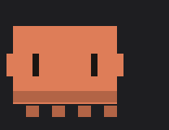

<div align="center">

# floofbot

**A plush little companion that lives above your Claude Code prompt.**<br>
It thinks when Claude thinks, types when Claude writes, runs when tools run — and cheers when the work is done.

<br>


<br><br>

### Install — one line, inside Claude Code

```
/plugin install floofbot-clay-blob --marketplace johnydec/floofbot
```

Claude Code then asks where to install it — pick **Install for you (user scope)** and press Enter.<br>
<sub>(<i>Project scope</i> would add the bot to the repository for everyone who works on it.)</sub>

<sub><a href="https://www.floofbot.site">floofbot.site</a> — pick a body and a colour, get your line</sub><br>
<sub>~9 MB · plush in <b>cmux</b>, <b>Ghostty</b>, <b>kitty</b> and <b>WezTerm</b>, pixel art in every other terminal · built on Claude Code’s early-access plugin hooks, tested on 2.1.302</sub>

</div>

<br>

## Eight moods, driven by what Claude is doing

<div align="center">

<picture>
  <source media="(prefers-color-scheme: dark)" srcset="assets/moods-dark.gif">
  
</picture>

</div>

| Claude Code event | Mood |
| --- | --- |
| you send a prompt | `thinking` |
| Claude streams a reply, or edits a file | `typing` |
| `Bash`, agents and long tools run | `working` |
| a permission dialog needs you | `waiting` |
| a tool fails | `error` |
| a turn with tools finishes | `celebrating` |
| nothing happens for a few minutes | `sleeping` |

## Any terminal: pixel mode

Terminals that can’t draw pictures (Terminal.app, iTerm2, VS Code’s terminal, tmux…) get a pixel floofbot instead: the same orange one for every preset, with all eight moods. Nothing to set up: the plugin picks the right one on its own.

<div align="center">

</div>

Prefer the pixels in Ghostty too, or the other way round? Start Claude Code with `FLOOFBOT_STYLE=pixel` (or `FLOOFBOT_STYLE=picture`).

## It loves a pat

`/floofbot pet` gets you a purr and `/floofbot feed` a happy crumb. Both run on your computer only: no model call, no tokens spent.

## Pick yours

<div align="center">

<picture>
  <source media="(prefers-color-scheme: dark)" srcset="assets/colors-dark.gif">
  
</picture>

<picture>
  <source media="(prefers-color-scheme: dark)" srcset="assets/bodies-dark.gif">
  
</picture>

</div>

Swap `floofbot-clay-blob` for any of the 28 presets:

| | classic | round | tall | blob |
| --- | --- | --- | --- | --- |
| **clay** | `floofbot-clay-classic` | `floofbot-clay-round` | `floofbot-clay-tall` | `floofbot-clay-blob` |
| **sky** | `floofbot-sky-classic` | `floofbot-sky-round` | `floofbot-sky-tall` | `floofbot-sky-blob` |
| **mint** | `floofbot-mint-classic` | `floofbot-mint-round` | `floofbot-mint-tall` | `floofbot-mint-blob` |
| **lilac** | `floofbot-lilac-classic` | `floofbot-lilac-round` | `floofbot-lilac-tall` | `floofbot-lilac-blob` |
| **rose** | `floofbot-rose-classic` | `floofbot-rose-round` | `floofbot-rose-tall` | `floofbot-rose-blob` |
| **graphite** | `floofbot-graphite-classic` | `floofbot-graphite-round` | `floofbot-graphite-tall` | `floofbot-graphite-blob` |
| **cream** | `floofbot-cream-classic` | `floofbot-cream-round` | `floofbot-cream-tall` | `floofbot-cream-blob` |

Switching later? Just install the new one: the newest preset draws, and the one you had steps back and tells you how to remove it (`/plugin uninstall <old one>`).

## Stay up to date

Claude Code turns auto-update off by default for marketplaces outside Anthropic's own, so turn it on once:

1. Run `/plugin` and go to the **Marketplaces** tab.
2. Select **floofbot**, then **Enable auto-update**.

From then on, Claude Code picks up new floofbot versions on its own after a session starts. Run `/reload-plugins` to switch the running session over, or just start a new one.

Prefer updating by hand?

```
/plugin marketplace update floofbot
```

or, from your shell: `claude plugin update floofbot-clay-blob@floofbot` (your preset's name).

## Cute outside, safe inside

A plugin runs inside your coding agent, so this one is built to be the most boring code you install.

- **Pinned downloads** — each preset is a zip on the [`packs-v0.5.0` release](https://github.com/johnydec/floofbot/releases/tag/packs-v0.5.0), pinned by SHA-256 in [`marketplace.json`](.claude-plugin/marketplace.json). Claude Code verifies it on every download and refuses a mismatch.
- **Watches, never touches** — every hook passes the event on unchanged. It can’t block, rewrite or approve anything.
- **No network, no processes** — it reads its own frames and draws them above the prompt. Its only write is one tiny file per preset in `~/.claude/fluffbots/`, touched when a session starts, when you send a prompt and when a turn ends — never on a timer — so two installed presets can agree which one draws.
- **Tiny surface** — the only engine APIs it uses are `$.fs.read` / `$.fs.list` (its own frames and the presets’ files), `$.fs.write` (its own file), `$.env` (to find `~/.claude`, and to tell whether your terminal can draw pictures), `$.store` (when it was installed), `$.session.id`, `$.clock`, `$.ui` and `$.state`.

Check a preset yourself:

```sh
curl -sL https://github.com/johnydec/floofbot/releases/download/packs-v0.5.0/floofbot-clay-blob.zip | shasum -a 256
```

## FAQ

<details><summary><b>Where does it work?</b></summary><br>
In Claude Code in any terminal. Where the terminal can draw pictures (the Kitty graphics protocol: cmux, Ghostty, kitty, WezTerm) you get the plush bot; everywhere else (Terminal.app, iTerm2, VS Code’s built-in terminal, tmux…) it draws itself in pixel art, with the same eight moods. The Claude desktop app and the VS Code extension’s chat panel don’t show it.
</details>

<details><summary><b>I installed it but don’t see the bot</b></summary><br>
Check that you’re in Claude Code in a terminal (not the desktop app), that Claude Code is up to date (<code>claude update</code> — the bot is built on its new plugin hooks, tested on 2.1.302), and that the window has room: 5 free rows above the prompt, and about 30 columns for the pixel bot.
</details>

<details><summary><b>Does it slow Claude Code down?</b></summary><br>
No. Frames are pre-rendered PNGs (176 px, 256 colours) that the terminal reads straight from disk, at ~30 fps only while Claude is working. At rest the bot plays its loop once and then holds still, so an idle window costs next to nothing. Claude’s own work never waits on the bot, and it uses no tokens.
</details>

<details><summary><b>Why no “waiting” at work?</b></summary><br>
Where an organization manages Claude Code, permission-dialog events only reach plugins the organization lists. Everything else still works.
</details>

<details><summary><b>I don’t get updates</b></summary><br>
Auto-update is off until you turn it on (see <a href="#stay-up-to-date">Stay up to date</a>). Without it, run <code>/plugin marketplace update floofbot</code>. An update shows up in the running session only after <code>/reload-plugins</code> or in a new session.
</details>

<details><summary><b>How do I remove it?</b></summary><br>
<code>/plugin uninstall floofbot-clay-blob</code> (your preset’s name).
</details>

<br>

<div align="center"><sub><a href="LICENSE">MIT licensed</a> · Unofficial fan project — not affiliated with Anthropic.</sub></div>
