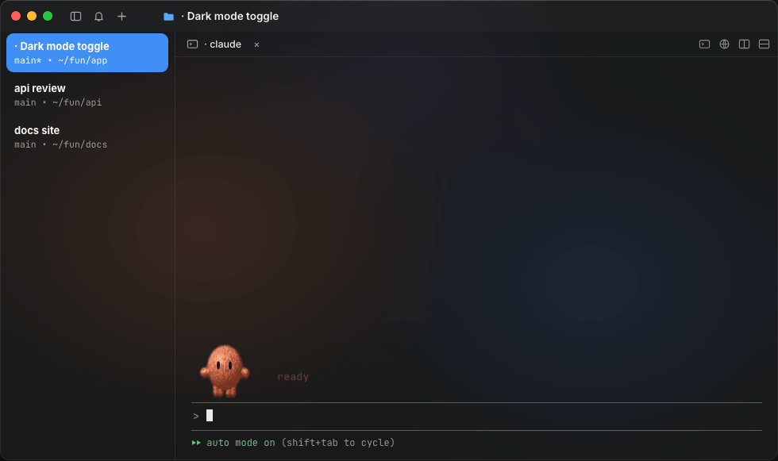
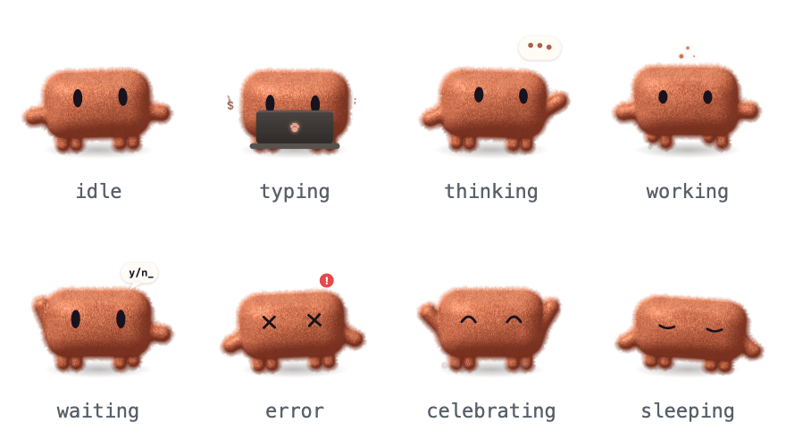
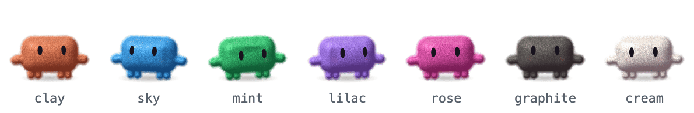
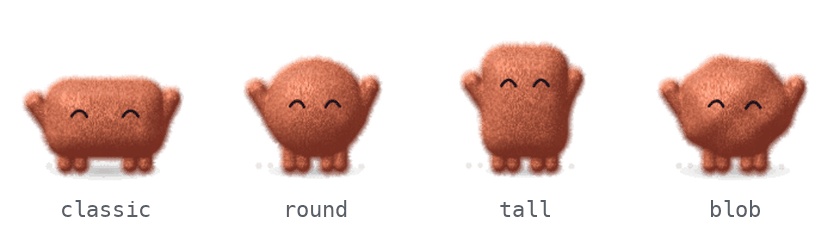

<div align="center">

# fluffbots

**A plush little companion that lives above your Claude Code prompt.**<br>
It thinks when Claude thinks, types when Claude writes, runs when tools run — and cheers when the tests go green.

<br>



<br><br>

### Install — one line, inside Claude Code

```
/plugin install fluffbot-clay-classic --marketplace johnydec/fluffbots
```

Claude Code then asks where to install it — pick **Install for you (user scope)** and press Enter.<br>
<sub>(<i>Project scope</i> would add the bot to the repository for everyone who works on it.)</sub>

<sub>~9 MB · needs a terminal with Kitty graphics: <b>cmux</b>, <b>Ghostty</b>, <b>kitty</b> or <b>WezTerm</b> · built on Claude Code’s early-access plugin hooks, tested on 2.1.301</sub>

</div>

<br>

## Eight moods, driven by what Claude is doing

<div align="center">

<picture>
  <source media="(prefers-color-scheme: dark)" srcset="assets/moods-dark.gif">
  
</picture>

</div>

| Claude Code event | Mood |
| --- | --- |
| you send a prompt | `thinking` |
| Claude streams a reply, or edits a file | `typing` |
| `Bash`, agents and long tools run | `working` |
| a permission dialog needs you | `waiting` |
| a tool fails | `error` |
| a turn with tools finishes | `celebrating` |
| nothing happens for a few minutes | `sleeping` |

## Pick yours

<div align="center">

<picture>
  <source media="(prefers-color-scheme: dark)" srcset="assets/colors-dark.gif">
  
</picture>

<picture>
  <source media="(prefers-color-scheme: dark)" srcset="assets/bodies-dark.gif">
  
</picture>

</div>

Swap `fluffbot-clay-classic` for any of the 28 presets:

| | classic | round | tall | blob |
| --- | --- | --- | --- | --- |
| **clay** | `fluffbot-clay-classic` | `fluffbot-clay-round` | `fluffbot-clay-tall` | `fluffbot-clay-blob` |
| **sky** | `fluffbot-sky-classic` | `fluffbot-sky-round` | `fluffbot-sky-tall` | `fluffbot-sky-blob` |
| **mint** | `fluffbot-mint-classic` | `fluffbot-mint-round` | `fluffbot-mint-tall` | `fluffbot-mint-blob` |
| **lilac** | `fluffbot-lilac-classic` | `fluffbot-lilac-round` | `fluffbot-lilac-tall` | `fluffbot-lilac-blob` |
| **rose** | `fluffbot-rose-classic` | `fluffbot-rose-round` | `fluffbot-rose-tall` | `fluffbot-rose-blob` |
| **graphite** | `fluffbot-graphite-classic` | `fluffbot-graphite-round` | `fluffbot-graphite-tall` | `fluffbot-graphite-blob` |
| **cream** | `fluffbot-cream-classic` | `fluffbot-cream-round` | `fluffbot-cream-tall` | `fluffbot-cream-blob` |

Switching later? Just install the new one: the newest preset draws, and the one you had steps back and tells you how to remove it (`/plugin uninstall <old one>`).

## Cute outside, safe inside

A plugin runs inside your coding agent, so this one is built to be the most boring code you install.

- **Pinned downloads** — each preset is a zip on the [`packs-v0.1.3` release](https://github.com/johnydec/fluffbots/releases/tag/packs-v0.1.3), pinned by SHA-256 in [`marketplace.json`](.claude-plugin/marketplace.json). Claude Code verifies it on every download and refuses a mismatch.
- **Watches, never touches** — every hook passes the event on unchanged. It can’t block, rewrite or approve anything.
- **No network, no processes** — it reads its own frames and draws a picture above the prompt. Its only write is one tiny file per preset in `~/.claude/fluffbots/`, touched when a session starts, when you send a prompt and when a turn ends — never on a timer — so two installed presets can agree which one draws.
- **Tiny surface** — the only engine APIs it uses are `$.fs.read` / `$.fs.list` (its own frames and the presets’ files), `$.fs.write` (its own file), `$.env` (to find `~/.claude`), `$.store` (when it was installed), `$.session.id`, `$.clock`, `$.ui` and `$.state`.

Check a preset yourself:

```sh
curl -sL https://github.com/johnydec/fluffbots/releases/download/packs-v0.1.3/fluffbot-clay-classic.zip | shasum -a 256
```

## FAQ

<details><summary><b>Where does it work?</b></summary><br>
In Claude Code in a terminal that can draw pictures (the Kitty graphics protocol): cmux, Ghostty, kitty and WezTerm. Terminal.app, iTerm2, VS Code’s built-in terminal, the Claude desktop app and the VS Code extension can’t show it — nothing breaks there, you just won’t see the bot.
</details>

<details><summary><b>I installed it but don’t see the bot</b></summary><br>
Check that your terminal is one of the four above, that Claude Code is up to date (<code>claude update</code> — the bot is built on its new plugin hooks, tested on 2.1.301), and that the window leaves 5 free rows above the prompt.
</details>

<details><summary><b>Does it slow Claude Code down?</b></summary><br>
No. Frames are pre-rendered PNGs (176 px, 256 colours) that the terminal reads straight from disk, at ~30 fps only while Claude is working. At rest the bot plays its loop once and then holds still, so an idle window costs next to nothing. Claude’s own work never waits on the bot, and it uses no tokens.
</details>

<details><summary><b>Why no “waiting” at work?</b></summary><br>
Where an organization manages Claude Code, permission-dialog events only reach plugins the organization lists. Everything else still works.
</details>

<details><summary><b>How do I remove it?</b></summary><br>
<code>/plugin uninstall fluffbot-clay-classic</code> (your preset’s name).
</details>

<br>

<div align="center"><sub>Unofficial fan project — not affiliated with Anthropic.</sub></div>
